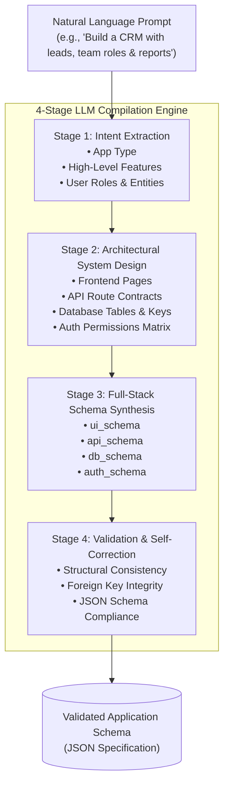

# AI App Compiler — Natural Language to Full-Stack Application Schema Pipeline

[](https://ai-compiler-95kg.onrender.com)
[](https://python.org)
[](https://fastapi.tiangolo.com)
[](https://openrouter.ai/)
[](LICENSE)

An agentic multi-stage LLM compilation pipeline that translates high-level natural language application descriptions into deterministic, production-ready system schemas covering UI layout, REST endpoints, database tables, and role-based access control.

---

## 🚀 Live Deployment
- **Live URL:** [https://ai-compiler-95kg.onrender.com](https://ai-compiler-95kg.onrender.com)

---

## 💡 How It Works (The 4-Stage Pipeline)

Rather than asking an LLM to generate an entire application in one shot—which frequently suffers from hallucinations, missing foreign keys, or incomplete specifications—**AI App Compiler** executes a chained 4-stage pipeline where each stage builds upon and refines the previous stage's structured output:



---

## 🛠️ Architecture & Technologies

- **Backend Framework**: [FastAPI](https://fastapi.tiangolo.com) with asynchronous routing and [Pydantic](https://docs.pydantic.dev) validation contracts.
- **LLM Gateway**: [OpenRouter API](https://openrouter.ai/) supporting multi-model execution and high-concurrency requests.
- **Frontend Playground**: Zero-dependency dark-mode web console with real-time JSON syntax-highlighted schema inspector.
- **Environment & Secrets**: `python-dotenv` with strict `.gitignore` isolation preventing accidental credential exposure.

---

## 📁 Repository Structure

```text
ai-compiler/
├── templates/
│   └── index.html      # Dark-mode interactive web playground
├── .env.example        # Safe template for environment variables
├── .gitignore          # Excludes .env, pycache, and virtual environments
├── main.py             # FastAPI entrypoint serving web UI and /generate API
├── pipeline.py         # 4-stage prompt chaining and OpenRouter integration
└── requirements.txt    # Python runtime dependencies
```

---

## 🚀 Quick Start

### 1. Clone & Set Up Virtual Environment

```bash
git clone https://github.com/sujitha611/ai-compiler.git
cd ai-compiler

python -m venv venv
# On Windows:
.\venv\Scripts\activate
# On Linux/macOS:
source venv/bin/activate
```

### 2. Install Dependencies

```bash
pip install -r requirements.txt
```

### 3. Configure Environment Variables

Create a `.env` file based on the template:

```bash
cp .env.example .env
```

Edit `.env` and add your OpenRouter API key:

```env
OPENROUTER_API_KEY=your_openrouter_api_key_here
```

### 4. Run the Application

```bash
python main.py
```

The web console will be available at **`http://localhost:8000`**.

---

## 🔌 API Reference

### Generate Schema
- **Endpoint**: `POST /generate`
- **Headers**: `Content-Type: application/json`
- **Request Body**:
  ```json
  {
    "prompt": "Build an inventory management system with warehouses, low-stock alerts, and manager vs clerk permissions"
  }
  ```
- **Response**:
  ```json
  {
    "success": true,
    "output": {
      "ui_schema": { "pages": [...] },
      "api_schema": { "endpoints": [...] },
      "db_schema": { "tables": [...] },
      "auth_schema": { "roles": [...] }
    }
  }
  ```

---

## 👤 Author

**Battu Jaya Sujitha**
- GitHub: [@sujitha611](https://github.com/sujitha611)
- Repository: [ai-compiler](https://github.com/sujitha611/ai-compiler)
